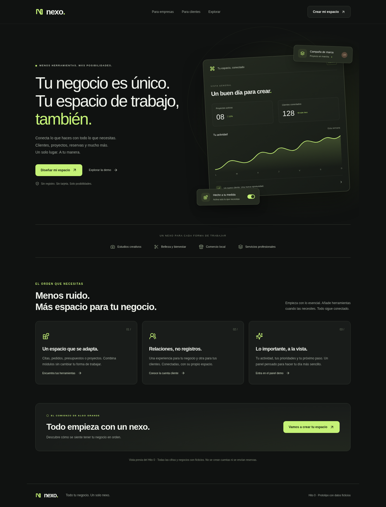

# AutonoService

**Tu negocio. Más fácil.**

Una aplicación modular con dos experiencias bajo una identidad global: **AutonoService**, para autónomos y empresas, y **Cliente**, completamente gratuita para consumidores. **AutonoSuite** es la mejora premium de gestión dentro de AutonoService: **Todo el potencial de tu negocio.**

**Estado: Hito 0, arquitectura y prototipos para revisión.** No hay autenticación, pagos, base de datos de producción ni reservas/mensajes enviados a otro usuario. Las pantallas de perfiles, catálogo y solicitudes utilizan datos ficticios locales. La marca, los accesos y los nuevos prototipos están implementados. Se han verificado la instalación desde el lockfile, TypeScript, 48 pruebas unitarias y la compilación; las 27 pruebas de navegador han pasado. Los resultados actuales se registran en [NOTAS_PRUEBAS.md](docs/NOTAS_PRUEBAS.md).

La referencia principal del producto es [ESPECIFICACION_MAESTRA.md](docs/ESPECIFICACION_MAESTRA.md). Lee también [AGENTS.md](AGENTS.md) y el resto de `docs/` antes de desarrollar.

## Identidad visual

El logotipo oficial y la paleta minimalista se mantienen en [la guía de identidad](docs/IDENTIDAD_VISUAL.md).
La aplicación utiliza fondo claro y crema de forma predeterminada, con modo oscuro opcional, y conserva la misma marca para AutonoService y Cliente.

## Abrir en VS Code con Windows

1. Descarga la rama `codex/hito-0`, descomprime el ZIP y abre esa carpeta mediante **Archivo → Abrir carpeta**. Debe contener `package.json`, `package-lock.json` y `src`.
2. Instala Node.js LTS si aún no lo tienes y vuelve a abrir VS Code. Se recomienda Node.js 22 o superior; Next.js admite >=20.9.
3. Abre **Terminal → Nueva terminal** y ejecuta:

   ```powershell
   npm.cmd ci
   ```

4. Cuando termine sin errores, ejecuta:

   ```powershell
   npm.cmd run dev
   ```

5. Abre la dirección que muestra Next.js en la terminal. Deja esa terminal abierta mientras revisas la web.

`npm.cmd` evita el bloqueo de `npm.ps1` en PowerShell sin cambiar la política de scripts. Si falta `package-lock.json`, comprueba que has abierto la carpeta de esta rama. En macOS/Linux puedes utilizar `npm ci` y `npm run dev`. El lockfile fija las versiones; no hace falta instalar Next.js globalmente.

## Probar en tu iPhone

Hoy se puede revisar la **web responsive en Safari**, conectando el iPhone y el ordenador a la misma Wi-Fi. Para la revisión en el teléfono, detén el servidor de desarrollo, ejecuta primero `npm.cmd run build` y, cuando termine sin errores, inicia:

```powershell
npm.cmd run start -- --hostname 0.0.0.0
```

Consulta la IPv4 del ordenador con `ipconfig` y abre en Safari esa IP con el puerto `3000`. `localhost` en el iPhone no apunta al ordenador. La guía [MOVIL_Y_PRUEBAS.md](docs/MOVIL_Y_PRUEBAS.md) explica los pasos, posibles bloqueos de red y el camino futuro de Expo Go, Development Builds, TestFlight, App Store y Android.

**No hay todavía una aplicación Expo que pueda abrirse con Expo Go ni una build en TestFlight.** La prueba local no crea una dirección web pública ni sincroniza datos entre dispositivos.

## Qué revisar en el prototipo

| Ruta | Experiencia del prototipo |
| --- | --- |
| `/` | Primera entrada: ¿Cómo quieres utilizar AutonoService? |
| `/onboarding` | Configuración profesional y recomendaciones por sector |
| `/registro` | Onboarding personal de Cliente, sin registro real |
| `/empresa` | Mi negocio: inicio sencillo, clientes, perfil y herramientas opcionales |
| `/empresa?vista=perfil` | Editor del negocio y catálogo que consulta Cliente |
| `/cliente` | Mi actividad, favoritos y perfil personal de demostración |
| `/explorar` | Directorio de cuatro negocios ficticios con filtros |
| `/negocio/photo` | Perfil de fotografía, catálogo y solicitudes de ejemplo |
| `/negocio/beauty`, `/negocio/bakery`, `/negocio/repairs` | Otros perfiles de demostración |
| `/mensajes` | Conversaciones y archivos locales desde ambas perspectivas demo |
| `/mi-plan` | Comparación profesional gratis/AutonoSuite sin cobros |

El selector **Mi negocio / Modo cliente** cambia de experiencia y recuerda la última elección sin crear otra cuenta. La selección de empresa es una demostración, no una membresía verificada.

Recorrido de interacción: editar el perfil del negocio → consultar el mismo catálogo como Cliente → preparar una solicitud de ejemplo → verla en Mi actividad. Los productos se consultan por mensaje; no existe checkout. Las fotos de presentación del negocio están separadas de los adjuntos privados de una conversación.

## Capturas de esta revisión



Revisa también [Mi negocio](docs/previews/empresa.png), [Mi negocio en móvil](docs/previews/empresa-movil.png), [Cliente](docs/previews/cliente.png), [Mi plan](docs/previews/mi-plan.png), [perfil del negocio](docs/previews/perfil-negocio.png), [perfil en tema claro](docs/previews/perfil-negocio-claro.png), [mensajes](docs/previews/mensajes.png) e [inicio en tema claro](docs/previews/inicio-claro.png). Las capturas corresponden al prototipo compilado con datos ficticios; no sustituyen la vista navegable ni demuestran un despliegue público.

## Comprobaciones

```bash
npm run typecheck
npm test
npm run build
npm run test:e2e
```

En PowerShell utiliza `npm.cmd`. El runner de `npm test` descubre las suites TypeScript de `tests/unit/` también en Windows. TypeScript genera primero los tipos de rutas para funcionar en una instalación nueva. Playwright usa un servidor en el puerto 3000 o inicia uno; si falta su navegador, ejecuta `npx playwright install chromium` (`npx.cmd` en PowerShell). Se puede seleccionar un Chromium instalado con `PLAYWRIGHT_CHROMIUM_EXECUTABLE_PATH`.

Para revisar la compilación, detén antes el servidor de desarrollo, ejecuta `npm run build` y después `npm run start -- --hostname 0.0.0.0`.

## Límites actuales y siguientes decisiones

- Los módulos son vistas demo. El catálogo funcional previsto se desarrolla por hitos, no de una sola vez.
- Cliente será gratuito. AutonoSuite muestra 99 € de pago único **provisional**; no se cobra ni se verifica una licencia real en esta fase.
- La licencia prevista cubre funciones locales adquiridas. Almacenamiento remoto, sincronización y otros servicios online tendrán políticas propias, sin promesa de infraestructura ilimitada.
- No hay autorización multiempresa de servidor, RLS, facturación real, geolocalización conectada o mapa operativo. Las vistas de permisos no garantizan seguridad.
- Los datos demo se guardan en cada navegador. Utiliza textos, fotos y archivos de prueba, nunca información real de clientes.

Consulta [ARQUITECTURA.md](docs/ARQUITECTURA.md), [HITO_0.md](docs/HITO_0.md) y [ROADMAP.md](docs/ROADMAP.md). **El Hito 1 requiere aprobación explícita del propietario.**
