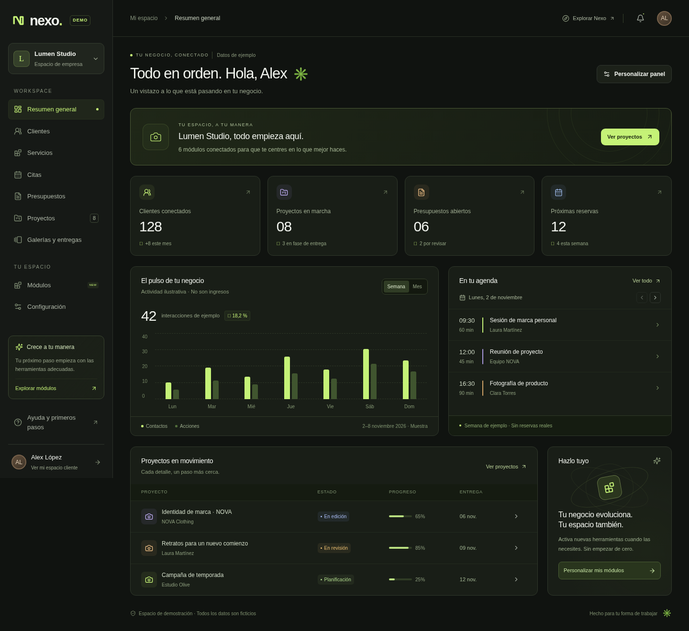

# Nexo — Hito 0

Prototipo visual navegable de una plataforma modular para empresas y una cuenta unificada para clientes. Interfaz oscura con acentos lima, componentes reutilizables y vistas responsive. **Sin backend conectado ni operaciones reales.**

## Ejecutar la vista previa

Desde la raíz del repositorio, con Node.js 22 o superior recomendado (Next.js admite Node.js >=20.9) y npm:

```bash
npm ci
npm run dev -- --hostname 0.0.0.0
```

El servidor escucha en el puerto `3000`. En tu equipo, abre `http://localhost:3000`. En un entorno remoto utiliza la vista previa o el reenvío de puertos que ofrezca tu editor, si está disponible. La instalación bloqueada por `package-lock.json` utiliza Next.js 16.4.3 y React 19.3.1.

| Ruta | Experiencia |
| --- | --- |
| `/` | Presentación y accesos a empresa y cliente |
| `/onboarding` | Configuración guiada: actividad, modalidad, módulos, identidad y resumen |
| `/empresa` | Panel de negocio, navegación modular, búsquedas y vistas de ejemplo |
| `/cliente` | Actividad personal, favoritos y preferencias de muestra |
| `/explorar` | Directorio ficticio con filtros; mapa futuro sin ubicaciones |

Para revisar una compilación de producción local:

```bash
npm run build
npm run start -- --hostname 0.0.0.0
```

Detén antes el servidor de desarrollo si utiliza el mismo puerto.

## Recorrido visual



También puedes revisar las capturas de [empresa en móvil](docs/previews/empresa-movil.png), [cuenta cliente](docs/previews/cliente.png) e [inicio](docs/previews/inicio.png). Son imágenes del prototipo con datos ficticios; no representan un despliegue público ni sustituyen la vista navegable.

## Comprobaciones

```bash
npm run typecheck
npm test
npm run build
npm run test:e2e
```

Las pruebas unitarias cubren el catálogo y la configuración local. Las pruebas de navegador cubren cuatro sectores, navegación modular, persistencia, errores de almacenamiento, cuenta cliente, directorio, menú móvil con teclado y adaptación a 360, 768 y 1440 px. Playwright reutiliza un servidor en el puerto 3000 o inicia uno automáticamente. `typecheck` genera primero los tipos de rutas de Next.js, por lo que también funciona en un checkout recién instalado.

Si no tienes Chromium en `/usr/bin/chromium`, instala el navegador de Playwright:

```bash
npx playwright install chromium
```

También puedes indicar un ejecutable ya instalado mediante `PLAYWRIGHT_CHROMIUM_EXECUTABLE_PATH`. Consulta el alcance y los resultados registrados en [docs/NOTAS_PRUEBAS.md](docs/NOTAS_PRUEBAS.md).

## Alcance y arquitectura

- 28 plantillas de sector componen un catálogo de 25 módulos; 23 tienen vista de demostración. Clientes es obligatorio; Cobros y Facturación permanecen planificados y deshabilitados.
- La navegación del negocio se adapta al activar o desactivar módulos. Cambiar de sector no crea una aplicación distinta.
- La configuración de empresa se valida al cargar y guardar en una clave versionada de `localStorage`. Los favoritos y las preferencias personales también permanecen exclusivamente en este navegador.
- Todos los contactos, negocios, métricas y actividades son ficticios. No se envían reservas, mensajes ni pagos. La preferencia de perfil público no publica ningún negocio.
- No hay autenticación, permisos de servidor, RLS ni base de datos de producción. La selección de módulos no constituye autorización.

Lee [AGENTS.md](AGENTS.md) y todos los documentos de [docs/](docs/) antes de desarrollar. [docs/HITO_0.md](docs/HITO_0.md) recoge decisiones y pendientes; [docs/ROADMAP.md](docs/ROADMAP.md) define las siguientes fases. **El Hito 1 requiere aprobación explícita del propietario.**

Nexo es un nombre provisional cuya disponibilidad comercial y de marca debe comprobarse. No introduzcas información real de clientes ni secretos en esta demo.
